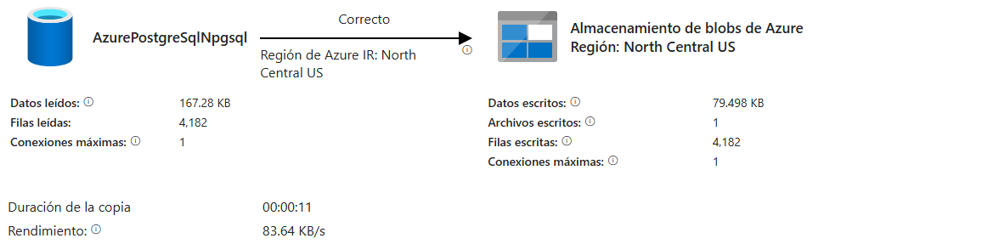

# 2. Fuentes de datos y exploración (extracción)

[← Volver al índice](../../report.md)

Las cifras de **referencia** son las del enunciado. Las cifras **observadas** provienen de:

- **el monitor de ADF:** filas leídas y escritas por cada actividad de copia en la ejecución del 26/11/2026;
- **el notebook de validación:** cardinalidad de las colecciones de MongoDB y cobertura de `PID` ([sección 6](06_validacion.md));
- **el script de la base** (`sources/scriptAmesDB.sql`): estructura, llaves y tipos de las tablas de PostgreSQL.

## 2.1 Extracción: qué se copió y cuánto

Cada fuente se copia primero a un archivo CSV de *staging* en Azure Blob Storage, en el contenedor `sources`. Las 11 copias (`PL_01_Copia_*`) corren en paralelo.

**Tabla 1.** Conteos de referencia y observados en la extracción (ejecución del 26/11/2026).

| Fuente | Objeto | Referencia (enunciado) | Filas leídas en ADF | Filas escritas en staging | Destino |
|---|---|---:|---:|---:|---|
| CSV | `AmesProperty.csv` | 2930 | 2.930 | 2.930 | `AmesPropertyData.csv` |
| PostgreSQL | `amesdbtemp` | 2930 | 2.930 | 2.930 | `Neon/AmesdbTempData.csv` |
| PostgreSQL | `floordetail` | 4182 | 4.182 | 4.182 | `Neon/FloorDetailData.csv` |
| PostgreSQL | `saleproperty` | 2930 | 2.930 | 2.930 | `Neon/SalesPropertyData.csv` |
| PostgreSQL | `typequality` | 5 | 5 | 5 | `Neon/TypequalityData.csv` |
| PostgreSQL | `mszoning` | 8 | 8 | 8 | `Neon/MszoningData.csv` |
| PostgreSQL | `mssubclass` | 16 | 16 | 16 | `Neon/MssubclassData.csv` |
| MongoDB | `garage` | 2773 | 2.773 | 2.773 | `mongo/garagedata.csv` |
| MongoDB | `bsmt` | 2851 | 2.851 | 2.851 | `mongo/bsmtdata.csv` |
| MongoDB | `pool` | 13 | 13 | 13 | `mongo/pooldata.csv` |
| MongoDB | `misc` | 106 | 106 | 106 | `mongo/miscdata.csv` |

*Fuente: ventana «Detalles» de cada actividad `CP_*` en ADF → Supervisar → Ejecuciones de canalización.*

Todas las copias leyeron y escribieron la misma cantidad de filas, y esa cantidad coincide con la referencia. Esto confirma que la extracción no perdió registros.

La Figura 1 muestra el caso que más interesa, `floordetail`, porque tiene varias filas por casa: ADF leyó 4.182 filas de PostgreSQL y escribió las mismas 4.182 en Blob Storage.

*Figura 1. Detalle de la actividad `CP_Neon_floordetail` (ADF → Supervisar), ejecución del 26/11/2026: 4.182 filas leídas y 4.182 escritas.*

## 2.2 Archivo AmesProperty.csv

- **Ubicación en el pipeline:** `sources/input/AmesProperty.csv`, a través del dataset `DS_SRC_Csv_AmesProperty`.
- **Formato observado:** separador `;`, con encabezado, texto ASCII y fin de línea CRLF.
- **Tamaño:** 2.930 filas × 19 columnas, igual que la referencia.
- **`PID`:** llave natural de la propiedad. Define el universo de 2.930 casas: la salida conserva exactamente esos `PID`, sin faltantes ni adicionales (prueba de cobertura del notebook).
- **Faltantes:** `Lot Frontage` y `Year Remod/Add` traen valores vacíos. El primero se completa por decisión del equipo; el segundo, por regla del enunciado ([sección 4](04_transformaciones.md)). `Alley` trae el texto `NA` como valor, que el enunciado acepta como marcador.
- **Aporte a la salida:** los 19 campos del lote y de la construcción, más el universo de `PID`.

## 2.3 PostgreSQL en Neon (base `amesDB`)

Según `sources/scriptAmesDB.sql`:

| Tabla | Propósito | Llave | Cardinalidad respecto a PID | Observado | Aporte a la salida |
|---|---|---|---|---:|---|
| `amesdbtemp` | Detalle constructivo: techo, exterior, calefacción, áreas por piso, chimeneas, porches, etc. | `pid` (PK) | 1:1 | 2.930 filas · 32 columnas | 32 campos, entre ellos los códigos de calidad y de zona |
| `floordetail` | Habitaciones y baños **por piso** | (`pid`, `Floor`) (PK) | **1:N** | 4.182 filas para 2.930 casas | `bedroom`, `fullBath`, `halfBath` (sumados) |
| `saleproperty` | Datos de la venta | `pid` (PK, FK a amesdbtemp) | 1:1 | 2.930 filas | `moSold`, `yrSold`, `saleType`, `saleCondition`, `salePrice` |
| `typequality` | Catálogo de calidad: 1=Ex, 2=Gd, 3=TA, 4=Fa, 5=Po | `id` | catálogo | 5 filas | Traduce `Exter Qual`, `Exter Cond`, `Heating QC` y `Kitchen Qual` |
| `mszoning` | Catálogo de zonas (`id` → código, por ejemplo 6 → `RL`) | `id` | catálogo | 8 filas | Traduce `MS Zoning` |
| `mssubclass` | Catálogo de clases de vivienda (`code` → descripción) | `code` | catálogo | 16 filas | Se extrae, pero la salida conserva el código numérico (20, 60…), como en el conjunto Ames original |

**Hallazgos que cambiaron el diseño:**

1. **`floordetail` es 1:N.** Su llave es (`pid`, `Floor`) y tiene 4.182 filas para 2.930 casas. Si se une sin agregar primero, las casas con más de un piso aparecerían repetidas (4.182 filas en lugar de 2.930). Por eso se agrega por `PID` **antes** de unir.
2. Las cuatro calidades y `MS Zoning` vienen como **identificadores numéricos** (`bigint` en el script): por ejemplo `Exter Qual = 3` significa `TA`. Hay que traducirlos con los catálogos.
3. `Central Air` es **booleano** en el script. La salida usa `Y` / `N`.
4. `Sale Date` es **timestamp**, por ejemplo `2010-05-23 00:00:00`. Solo se necesitan el mes y el año.
5. El enunciado indica 35 columnas para `amesdbtemp`, pero el script define **32**. Las 32 cubren todos los campos que la salida necesita de esa tabla.

## 2.4 MongoDB Atlas (base `test`)

| Colección | Documentos (ref. / observado en ADF) | PID duplicados o ausentes (notebook) | Cobertura del universo | Casas sin documento |
|---|---:|---:|---:|---:|
| `garage` | 2773 / 2.773 | 0 | 2.773 de 2.930 (94,6 %) | 157 |
| `bsmt` | 2851 / 2.851 | 0 | 2.851 de 2.930 (97,3 %) | 79 |
| `pool` | 13 / 13 | 0 | 13 de 2.930 (0,4 %) | 2.917 |
| `misc` | 106 / 106 | 0 | 106 de 2.930 (3,6 %) | 2.824 |

- **Tipos:** el `PID` y los campos numéricos vienen como `$numberLong` o `$numberInt` en el JSON extendido. En la copia se mapean con rutas `$['PID']`, y luego se convierten a texto (`toString(toLong(PID))`) para que empaten con el CSV.
- **Ausencias:** se distinguen tres casos:
  - **documento ausente:** la casa no está en la colección, por ejemplo 157 casas sin `garage`;
  - **campo ausente:** el documento existe pero le falta la llave;
  - **cero válido:** `Pool Area = 0` o `Garage Cars = 0` informados por la fuente.

  Los dos primeros se convierten en `NA` (texto) o `0` (número). El tercero se conserva tal cual.

## 2.5 Síntesis

| Fuente y objeto | Llave | Cardinalidad respecto a PID | Tamaño observado | Problema de calidad | Aporte a la salida |
|---|---|---|---:|---|---|
| CSV `AmesProperty` | PID | 1:1 (universo) | 2.930 | `Lot Frontage` y `Year Remod/Add` con vacíos | 19 campos |
| PG `amesdbtemp` | pid | 1:1 | 2.930 | códigos numéricos; `Central Air` booleano | 32 campos |
| PG `floordetail` | pid + Floor | 1:N | 4.182 | varias filas por casa | 3 campos sumados |
| PG `saleproperty` | pid | 1:1 | 2.930 | fecha con hora | 5 campos |
| PG `typequality` / `mszoning` | id | catálogo | 5 / 8 | — | traducción de códigos |
| Mongo `garage` | PID | 0..1 | 2.773 | 157 casas sin documento; campos que pueden faltar | 7 campos |
| Mongo `bsmt` | PID | 0..1 | 2.851 | 79 casas sin documento; campos que pueden faltar | 11 campos |
| Mongo `pool` | PID | 0..1 | 13 | 2.917 casas sin documento | 2 campos |
| Mongo `misc` | PID | 0..1 | 106 | 2.824 casas sin documento | 2 campos |
