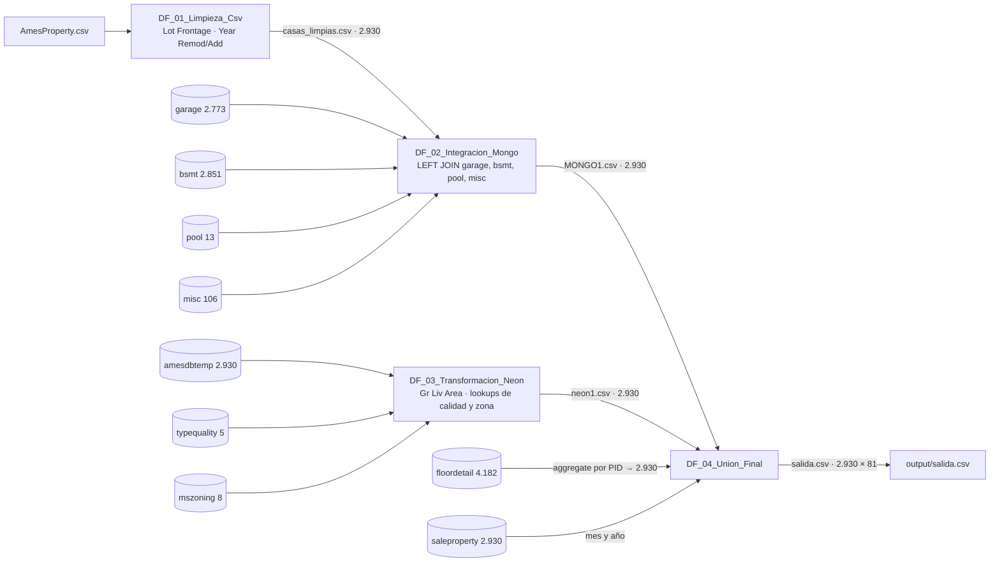
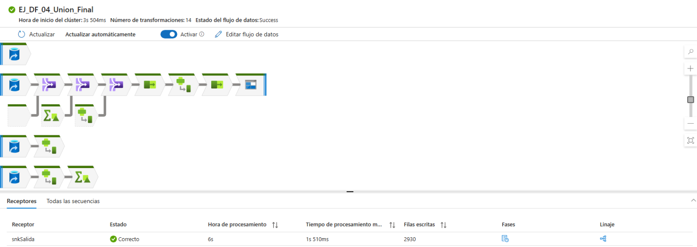

# 3. Diseño de la integración

[← Volver al índice](../../report.md)

## 3.1 Universo de propiedades

El **CSV `AmesProperty.csv`** define el universo de `PID`: tiene 2.930 PID únicos y sin vacíos. Todas las uniones posteriores son **LEFT JOIN desde ese universo**. Así se conserva cada propiedad aunque no tenga registro en una colección de MongoDB.

Como `amesdbtemp` y `saleproperty` también tienen 2.930 PID y cubren el 100 % del universo, un INNER JOIN habría dado el mismo resultado. Aun así, el LEFT JOIN hace explícito que el CSV manda.

## 3.2 Flujo de integración

## 3.3 Decisiones de unión

**Tabla 2.** Uniones del pipeline. Los conteos «después» son las filas escritas por cada sink en la ejecución del 26/11/2026.

| Paso (data flow) | Entrada izquierda | Entrada derecha | Preparación previa | Tipo | Llave | Filas antes → después | Justificación |
|---|---|---|---|---|---|---|---|
| `joinPromedioBarrio` (DF_01) | CSV (2.930) | promedio de `Lot Frontage` por `Neighborhood` (1 fila por barrio) | `aggregate` por barrio | LEFT | Neighborhood | 2.930 → 2.930 | El lado derecho tiene una fila por barrio, así que no multiplica |
| `joinGarage` (DF_02) | casas limpias (2.930) | garage (2.773) | `PID` a texto | LEFT | PID | 2.930 → 2.930 | Hay 157 casas sin garaje y deben conservarse |
| `joinSotano` (DF_02) | resultado anterior | bsmt (2.851) | `PID` a texto | LEFT | PID | 2.930 → 2.930 | Hay 79 casas sin documento de sótano |
| `joinPiscina` (DF_02) | resultado anterior | pool (13) | `PID` a texto | LEFT | PID | 2.930 → 2.930 | Solo 13 casas tienen piscina |
| `joinMisc` (DF_02) | resultado anterior | misc (106) | `PID` a texto | LEFT | PID | 2.930 → 2.930 (sink `snkCasasMongo`) | Solo 106 casas tienen documento en `misc` |
| `lkpExterQual` … `lkpMSZoning` (DF_03) | amesdbtemp (2.930) | typequality (5) / mszoning (8) | — | LOOKUP (`multiple: false`) | Id del catálogo | 2.930 → 2.930 (sink `snkNeon`) | Catálogo con llave única; un lookup no puede multiplicar filas |
| `joinNeon` (DF_04) | casas + Mongo (2.930) | Neon (2.930) | `PID` como texto en ambos lados | LEFT | PID | 2.930 → 2.930 | Relación 1:1 |
| `joinPisos` (DF_04) | resultado anterior | `aggPisosPorCasa` (2.930) | **`aggregate` por PID** de las 4.182 filas | LEFT | PID | 2.930 → 2.930 | Sin agregar antes, las casas de 2 pisos se duplicarían (4.182 filas) |
| `joinVentas` (DF_04) | resultado anterior | ventas (2.930) | mes y año derivados | LEFT | PID | 2.930 → 2.930 (sink `snkSalida`) | Relación 1:1 |

## 3.4 Cómo comprobamos que no se perdieron ni multiplicaron propiedades

1. **Por ejecución:** los cuatro sinks (`snkCasasLimpias`, `snkCasasMongo`, `snkNeon` y `snkSalida`) escribieron exactamente **2.930** filas, según el monitor de ADF (Figura 2).

   

   *Figura 2. Detalle de la ejecución de `DF_04_Union_Final` (ADF → Supervisar), 26/11/2026: estado Success y 2.930 filas escritas por `snkSalida`, después de las tres uniones.*
2. **Por PID:** el notebook verificó en `salida.csv` que hay 0 PID duplicados, 0 PID faltantes y 0 PID adicionales frente al CSV base.
3. **Por colección:** la cardinalidad de `garage`, `bsmt`, `pool` y `misc` coincide documento a documento, sin PID duplicados ni ausentes (pruebas 7.x del notebook).

Que el pipeline termine sin error no prueba que las uniones sean correctas. Las tres comprobaciones anteriores sí lo hacen.
