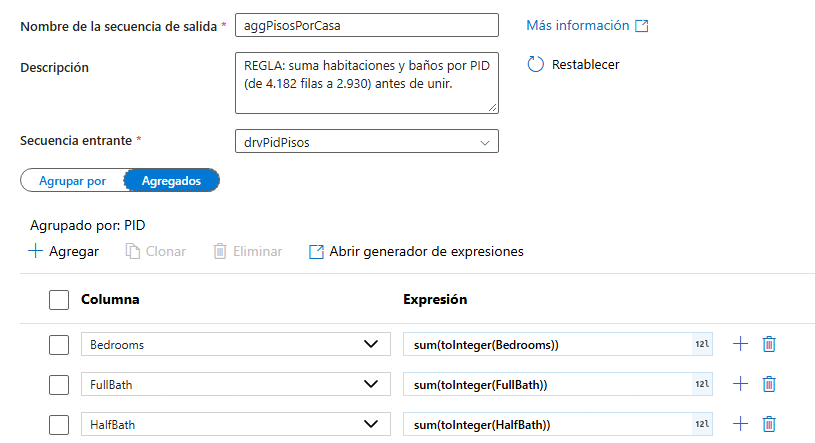
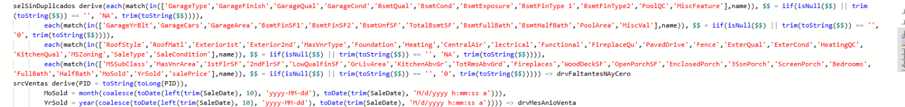

# 4. Transformaciones

[← Volver al índice](../../report.md)

Después de la extracción, los datos están copiados tal cual en Blob Storage, pero todavía no sirven como salida. Hay campos que no existen en ninguna fuente y hay que calcularlos, como el área habitable o el total de baños. Otros vienen como códigos que hay que traducir, otros traen vacíos que hay que reemplazar, y cada fuente usa su propio formato. Esta sección explica cada una de esas reglas:

- **qué pide** el enunciado;
- **por qué** hace falta;
- **cómo lo resuelve ADF**, primero en palabras y luego con la expresión real;
- **cómo se comprobó** que quedó bien.

Los nombres de los pasos son los que aparecen en ADF y en `pipelines/dataflow/*.json`.

## 4.0 Tipos de transformación que usamos en ADF

Todas las reglas se implementaron en **Mapping Data Flows**, que son flujos visuales de pasos. Se usaron cinco tipos de paso:

| Tipo de paso (prefijo) | Qué hace | Ejemplo en el proyecto |
|---|---|---|
| **Columna derivada** (`drv`) | Crea una columna nueva o modifica una existente con una fórmula | `drvGrLivAreaAire` calcula el área habitable |
| **Agregado** (`agg`) | Agrupa filas y resume valores, por ejemplo con una suma o un promedio | `aggPisosPorCasa` suma habitaciones y baños por casa |
| **Búsqueda** (`lkp`) | Busca un valor en una tabla de referencia (catálogo) | `lkpExterQual` traduce `3` a `TA` |
| **Unión** (`join`) | Pega columnas de otra fuente usando una llave común (`PID`) | `joinGarage` pega los datos de garaje |
| **Selección** (`sel`) | Elige, ordena y renombra columnas | `selEsquemaSalida` deja las 81 columnas en camelCase |

El orden importa. Primero se limpia cada fuente por separado (DF_01 para el CSV, DF_03 para Neon), luego se unen las fuentes (DF_02 y DF_04), y al final se aplican la regla de faltantes y el formato de salida (DF_04).

## 4.1 Área habitable (`grLivArea`)

**Qué pide el enunciado:** `Gr Liv Area` es la superficie habitable sobre el nivel del suelo, en pies cuadrados. Se calcula como la suma de `1st Flr SF` (primer piso), `2nd Flr SF` (segundo piso) y `Low Qual Fin SF` (área terminada de baja calidad).

**Por qué hace falta:** ninguna fuente trae este campo; hay que calcularlo a partir de los tres anteriores, que vienen en la tabla `amesdbtemp` de Neon.

**Cómo lo resuelve ADF:** una columna derivada suma las tres áreas. Antes de sumar, cada área vacía se reemplaza por 0 con `coalesce`. Así, una casa sin segundo piso suma 0 por ese concepto y el total no queda vacío.

- **Dónde:** `DF_03_Transformacion_Neon` → `drvGrLivAreaAire`.
- **Expresión:**
  ```
  GrLivArea = toInteger(coalesce({1stFlrSF}, 0)) + toInteger(coalesce({2ndFlrSF}, 0)) + toInteger(coalesce(LowQualFinSF, 0))
  ```
- **Validación:** el notebook revisa **fila por fila** que `1stFlrSf + 2ndFlrSf + lowQualFinSf = grLivArea`. Hubo **0 filas** con diferencia.

## 4.2 Habitaciones y baños (`bedroom`, `fullBath`, `halfBath`)

**Qué pide el enunciado:** calcular el total de habitaciones, baños completos y medios baños de cada propiedad, teniendo en cuenta que una casa puede tener varios pisos.

**Por qué hace falta:** la tabla `floordetail` guarda esos datos **por piso**, no por casa: tiene 4.182 filas para 2.930 casas. Si se uniera directamente con el resto, cada casa de dos pisos aparecería dos veces en la salida. Por eso primero hay que resumir los pisos en una sola fila por casa.

**Cómo lo resuelve ADF:** un paso de agregado agrupa las filas por `PID` y suma las habitaciones y los baños de todos los pisos. El resultado tiene exactamente una fila por casa, y recién entonces se une con las demás fuentes (`joinPisos`).

- **Dónde:** `DF_04_Union_Final` → `drvPidPisos` → `aggPisosPorCasa`, **antes** de `joinPisos`.
- **Expresión** (Figura 3):
  ```
  aggregate(groupBy(PID), Bedrooms = sum(toInteger(Bedrooms)), FullBath = sum(toInteger(FullBath)), HalfBath = sum(toInteger(HalfBath)))
  ```
- **Cardinalidad:** pasa de 4.182 filas a **2.930** filas, una por PID.
- **Ejemplo:** el PID 527105010 tiene dos filas en `floordetail`:
  - piso 1: 1 habitación, 0 baños completos y 1 medio baño;
  - piso 2: 2 habitaciones, 2 baños completos y 0 medios baños.

  En la salida queda `bedroom = 3`, `fullBath = 2` y `halfBath = 1`.
- **Validación:** el notebook suma `FloorDetail` por PID y compara con la salida. Las diferencias fueron `bedroom 0`, `fullBath 0` y `halfBath 0`.



*Figura 3. Configuración del paso `aggPisosPorCasa` en `DF_04_Union_Final`: agrupa por `PID` y suma `Bedrooms`, `FullBath` y `HalfBath`.*

## 4.3 Fecha de venta (`moSold`, `yrSold`)

**Qué pide el enunciado:** la tabla `saleproperty` trae la fecha de venta completa, pero la salida solo debe tener el **mes** (`Mo Sold`) y el **año** (`Yr Sold`).

**Por qué hace falta:** `Sale Date` es un `timestamp` en PostgreSQL. Al copiarse a staging llega como texto con hora, por ejemplo `2010-05-23 00:00:00`, y de ahí hay que sacar el 5 y el 2010.

**Cómo lo resuelve ADF:** una columna derivada toma los primeros 10 caracteres del texto (`2010-05-23`) y los convierte en fecha. Después extrae el mes con `month()` y el año con `year()`. Si algún día la fecha llegara en otro formato, `coalesce` prueba una segunda forma de leerla, `M/d/yyyy h:mm:ss a`.

- **Dónde:** `DF_04_Union_Final` → `drvMesAnioVenta` (Figura 4, últimas líneas).
- **Expresión:**
  ```
  MoSold = month(coalesce(toDate(left(trim(SaleDate),10),'yyyy-MM-dd'), toDate(trim(SaleDate),'M/d/yyyy h:mm:ss a')))
  YrSold = year(...misma fecha...)
  ```
- **Validación:** el notebook compara contra `saleproperty` por PID. Las diferencias fueron `moSold 0` y `yrSold 0`.

## 4.4 Año de remodelación (`yearRemodAdd`)

**Qué pide el enunciado:** si `Year Remod/Add` no tiene fecha de remodelación, en lugar de dejarlo nulo se debe poner el año de construcción (`Year Built`).

**Por qué hace falta:** varias casas del CSV nunca se remodelaron y tienen ese campo vacío. Un vacío no está permitido en la salida, y un 0 no tendría sentido como año.

**Cómo lo resuelve ADF:** una columna derivada revisa cada casa. Si `Year Remod/Add` está vacío, o solo tiene espacios, toma el valor de `Year Built`; si tiene un año, lo conserva. Esto se hace en DF_01, al limpiar el CSV.

- **Dónde:** `DF_01_Limpieza_Csv` → `drvYearRemodAdd`.
- **Expresión:**
  ```
  {YearRemod/Add} = iif(isNull({YearRemod/Add}) || trim(toString({YearRemod/Add})) == '', toInteger({YearBuilt}), toInteger({YearRemod/Add}))
  ```
  Se lee así: *si* (`iif`) el valor es nulo *o* (`||`) es texto vacío, usa `YearBuilt`; *si no*, deja el valor original.
- **Validación:** el notebook tiene dos pruebas que distinguen el dato original del sustituido:
  - una revisa que no quede ningún vacío ni 0;
  - la otra compara cada PID con la fuente, esperando el valor original si existía y `Year Built` si faltaba.

  Ambas dieron **0 diferencias**.

## 4.5 Variables de calidad y catálogos

**Qué pide el enunciado:** la salida debe mostrar las calidades con sus códigos de texto (`Ex`, `Gd`, `TA`, `Fa`, `Po`), igual que el conjunto Ames original.

**Por qué hace falta:** en Neon, `Exter Qual`, `Exter Cond`, `Heating QC`, `Kitchen Qual` y `MS Zoning` no guardan el texto, sino un **número** que apunta a una tabla de referencia (catálogo). Por ejemplo, `Exter Qual = 3` significa `TA` (*Average/Typical*) según `typequality`.

**Cómo lo resuelve ADF:** un paso de búsqueda (*lookup*) toma el número de cada casa, lo busca en el catálogo y trae el código de texto. Hay un lookup por cada campo. Como en cada catálogo el `id` es único, cada casa encuentra a lo sumo una coincidencia, así que el lookup no puede duplicar filas.

- **Dónde:** `DF_03_Transformacion_Neon`.
  - `lkpExterQual`, `lkpExterCond`, `lkpHeatingQC` y `lkpKitchenQual` usan `typequality`, que tiene 5 filas.
  - `lkpMSZoning` usa `mszoning`, que tiene 8 filas.
- **Operación:** el lookup por `Id` (`multiple: false`) va seguido de una columna derivada con el código, por ejemplo `ExterQual_txt = toString(Code)`. Así `3` se convierte en `TA` y `1` en `Ex`; para zona, `6` se convierte en `RL`.
- **Códigos sin correspondencia:** si un número no existiera en el catálogo, el campo quedaría vacío y luego pasaría a `NA` (regla 4.6). El notebook no encontró ninguna diferencia, así que todos los códigos se tradujeron.
- **Validación:** el notebook compara por PID los códigos derivados de `TypeQuality`. Las diferencias fueron 0 en `exterQual`, `exterCond`, `heatingQC` y `kitchenQual`.
- **`Central Air`:** es un caso parecido. En Neon es un valor verdadero/falso (`true`/`false`), y la salida usa `Y`/`N`. La conversión se hace una sola vez, en `drvGrLivAreaAire` (ver la [sección 5.6](05_implementacion_adf.md)).

## 4.6 Datos ausentes de MongoDB (`NA` / `0`)

**Qué pide el enunciado:** al cargar `garage`, `pool`, `bsmt` y `misc`, si no se encuentran los datos, hay que poner `NA` si la variable es cualitativa (texto) y `0` si es numérica.

**Por qué hace falta:** las colecciones de MongoDB **no tienen un documento para todas las casas**. Solo 13 casas tienen piscina y 157 no tienen garaje. Además, algunos documentos pueden no traer todos los campos. Al unir por `PID` con LEFT JOIN, esas casas se conservan pero sus columnas quedan vacías. El enunciado no permite vacíos, así que hay que rellenarlas.

**Cómo lo resuelve ADF:** después de todas las uniones, una columna derivada recorre dos grupos de columnas:

- en las de **texto**, cada valor vacío pasa a `NA`;
- en las **numéricas**, cada valor vacío pasa a `0`.

En lugar de escribir una fórmula por columna, se usa un patrón (`each(match(...))`) que aplica la misma regla a toda la lista de columnas.

- **Dónde:** `DF_04_Union_Final` → `drvFaltantesNAyCero`, después de todas las uniones (Figura 4).
- **Regla:**
  - En los campos **cualitativos** (`GarageType`, `GarageFinish`, `GarageQual`, `GarageCond`, `BsmtQual`, `BsmtCond`, `BsmtExposure`, `BsmtFinType1/2`, `PoolQC`, `MiscFeature`), un valor nulo o vacío se convierte en `'NA'`.
  - En los campos **numéricos** (`GarageYrBlt`, `GarageCars`, `GarageArea`, `BsmtFinSF1/2`, `BsmtUnfSF`, `TotalBsmtSF`, `BsmtFullBath`, `BsmtHalfBath`, `PoolArea`, `MiscVal`), se convierte en `'0'`.
- **Los tres casos que distingue la regla:**
  - **Documento ausente:** la casa no está en la colección. Después del LEFT JOIN todos sus campos de esa colección quedan vacíos y la regla los rellena. Por ejemplo, las 157 casas sin `garage` quedan con `garageType = NA` y `garageArea = 0`.
  - **Campo ausente:** el documento existe pero le falta un campo. Ese campo queda vacío y recibe el mismo tratamiento.
  - **Cero válido:** si la fuente ya traía un `0`, por ejemplo `Garage Cars = 0`, se conserva, porque la regla solo actúa sobre valores vacíos.
- **Validación:** el notebook compara valor por valor las cuatro colecciones (pruebas 7.x) y no encontró diferencias. Las pruebas de marcadores confirman que solo se usan `NA` y `0`.



*Figura 4. Script de `DF_04_Union_Final` (vista «Script» del data flow). Las cuatro primeras líneas son `drvFaltantesNAyCero`: los campos de texto vacíos pasan a `NA` y los numéricos a `0`. Las dos últimas son `drvMesAnioVenta`, que obtiene el mes y el año de `SaleDate` (sección 4.3).*

La misma regla se aplica de forma preventiva al resto de los campos de texto y numéricos: en `DF_01` para el CSV y en `DF_04` para Neon. Así ninguna columna de la salida queda con vacíos, venga de la fuente que venga.

## 4.7 Transformaciones opcionales y decisiones del equipo

- **`Neighborhood`, `Condition 1`, `Condition 2` y `Lot Shape`:** el enunciado permite dejarlos como vienen o convertirlos a códigos cortos (por ejemplo `North Ames` → `Names`). El equipo **conservó los valores originales**, porque son más legibles para quien lea la salida. El notebook confirmó que esas columnas conservan los valores de forma consistente.
- **`Lot Frontage` (pies lineales de calle frente al lote):** algunas casas no tienen este dato. Por decisión del equipo se rellena con el **promedio de su barrio**, en tres pasos de DF_01:
  1. `aggPromedioLotFrontage` calcula el promedio de `Lot Frontage` en cada barrio;
  2. `joinPromedioBarrio` pega ese promedio a cada casa según su barrio;
  3. `drvLotFrontage` usa el promedio solo donde el valor original está vacío.

  Se prefirió esto a un 0, que daría a entender que la casa no tiene frente a la calle. Esta imputación no la exige el enunciado.
- **Encabezados:** las 81 columnas van en **camelCase** (`lotFrontage`, `yearRemodAdd`, `1stFlrSf`…) y conservan `PID`, `MS` y `QC` en mayúscula, como pide el enunciado. Las renombra y ordena el paso final `selEsquemaSalida`, justo antes de escribir `salida.csv`.

## Matriz de transformaciones

| Campo de salida | Fuente y campo original | Regla | Implementación en ADF | Faltantes | Evidencia |
|---|---|---|---|---|---|
| `grLivArea` | amesdbtemp: 1st, 2nd y Low Qual Fin SF | suma | DF_03 `drvGrLivAreaAire` | ausente = 0 | Prueba 4 «Gr Liv Area por fila»: 0 fallas |
| `bedroom`, `fullBath`, `halfBath` | floordetail (1:N) | suma por PID | DF_04 `aggPisosPorCasa` | — | Prueba 4 «Agregación FloorDetail»: 0 diferencias |
| `moSold`, `yrSold` | saleproperty `Sale Date` | mes y año | DF_04 `drvMesAnioVenta` | — | Prueba 4 «Mes y año»: 0 diferencias |
| `yearRemodAdd` | CSV `Year Remod/Add` | vacío → `Year Built` | DF_01 `drvYearRemodAdd` | vacío → `Year Built` | Pruebas 4 «Year Remod Add»: 0 diferencias |
| `exterQual`, `exterCond`, `heatingQC`, `kitchenQual` | amesdbtemp (id) + typequality | id → código | DF_03 `lkp*` + `drv*` | sin código → NA | Prueba 6: 0 diferencias |
| `MSZoning` | amesdbtemp (id) + mszoning | id → código | DF_03 `lkpMSZoning` | sin código → NA | Lookup con llave única sobre el catálogo `mszoning` |
| `centralAir` | amesdbtemp booleano | true → Y, false → N | DF_03 `drvGrLivAreaAire` | — | Conversión única en DF_03 (sección 5.6) |
| `garage*`, `bsmt*`, `pool*`, `misc*` | colecciones MongoDB | LEFT JOIN + NA / 0 | DF_02 `join*` + DF_04 `drvFaltantesNAyCero` | NA / 0 | Pruebas 7.x: cardinalidad y valores, 0 diferencias |
| `lotFrontage` | CSV | vacío → promedio del barrio | DF_01 `drvLotFrontage` | vacío → promedio del barrio | Decisión del equipo (no la evalúa el notebook) |
| 81 encabezados | — | camelCase, en orden | DF_04 `selEsquemaSalida` | — | Prueba 3: los 81 coinciden |
