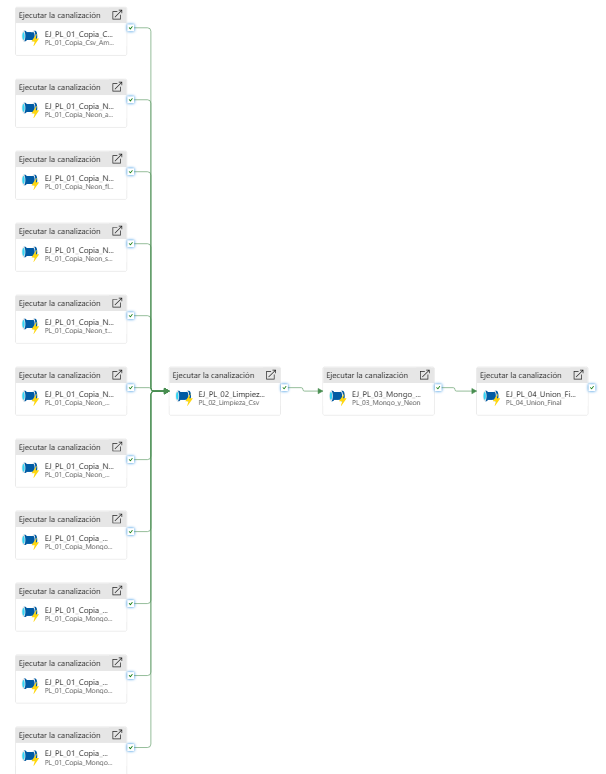
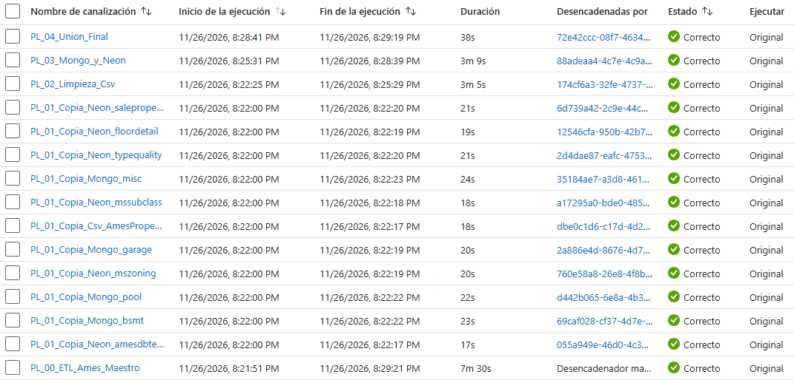

# 5. Implementación en Azure Data Factory

[← Volver al índice](../../report.md)

La factoría es `adf-ames-etlinmo-corregido`, en la región North Central US. Sus recursos están versionados en [`pipelines/`](../../pipelines/) mediante la integración Git de ADF, con la rama de colaboración `main`, la rama de publicación `adf_publish` y la carpeta raíz `/pipelines/`. El detalle de cada recurso está en la [documentación del pipeline](../../pipelines/pipelines.md).

## 5.1 Servicios vinculados (sin parámetros sensibles)

| Servicio vinculado | Tipo | Uso |
|---|---|---|
| `LS_Blob_Ames` | Azure Blob Storage | Contenedor `sources`: entrada, staging, intermedios y salida |
| `LS_Neon_AmesDB` | Azure Database for PostgreSQL (conector v1) | Base `amesDB` en Neon, conexión cifrada (SSL) |
| `LS_Mongo_Atlas` | MongoDB Atlas | Base `test` |

Las contraseñas no están en el repositorio. ADF las guarda cifradas, y la plantilla ARM las recibe como parámetros `secureString`.

## 5.2 Datasets (26)

| Carpeta | Prefijo | Cantidad | Ejemplo |
|---|---|---:|---|
| 01_Origen | `DS_SRC_` | 11 | `DS_SRC_Neon_floordetail` (tabla `floordetail`) |
| 02_Staging | `DS_STG_` | 11 | `DS_STG_Mongo_garage` (`mongo/garagedata.csv`) |
| 03_Intermedios | `DS_INT_` | 3 | `DS_INT_CasasLimpias` (`clean/casas_limpias.csv`) |
| 04_Salida | `DS_OUT_` | 1 | `DS_OUT_Salida` (`output/salida.csv`, separador `;`) |

## 5.3 Pipelines y secuencia de ejecución

```
PL_00_ETL_Ames_Maestro
 ├─ 11 × Execute Pipeline en paralelo → PL_01_Copia_<fuente>_<objeto>   (actividad Copy CP_*)
 ├─ si las 11 terminan bien → PL_02_Limpieza_Csv     → DF_01_Limpieza_Csv
 ├─ si termina bien         → PL_03_Mongo_y_Neon     → DF_02_Integracion_Mongo ∥ DF_03_Transformacion_Neon
 └─ si termina bien         → PL_04_Union_Final      → DF_04_Union_Final → output/salida.csv
```

Las dependencias usan la condición **Succeeded**. Si una copia falla, los data flows no corren con datos incompletos. La Figura 5 muestra el pipeline en ADF: las 11 copias a la izquierda convergen en `PL_02`, y de ahí la cadena sigue a `PL_03` y `PL_04`.



*Figura 5. Captura de pantalla de `PL_00_ETL_Ames_Maestro` en ADF Studio: 11 actividades Execute Pipeline de copia en paralelo y, en secuencia, `PL_02_Limpieza_Csv` → `PL_03_Mongo_y_Neon` → `PL_04_Union_Final`.*

## 5.4 Data flows

| Data flow | Transformaciones | Entradas → salida | Reglas que implementa |
|---|---:|---|---|
| `DF_01_Limpieza_Csv` | 8 | CSV en staging → `clean/casas_limpias.csv` | Lot Frontage por barrio, Year Remod/Add, NA / 0 del CSV |
| `DF_02_Integracion_Mongo` | 15 | casas limpias + 4 colecciones → `clean/MONGO1.csv` | `PID` a texto y 4 LEFT JOIN |
| `DF_03_Transformacion_Neon` | 21 | amesdbtemp + typequality + mszoning → `clean/neon1.csv` | Gr Liv Area, Central Air Y/N, 5 lookups de catálogo |
| `DF_04_Union_Final` | 14 | MONGO1 + neon1 + floordetail + saleproperty → `output/salida.csv` | Agregación de pisos, mes y año, uniones, NA / 0 y 81 columnas en camelCase |

La Figura 6 muestra `DF_04_Union_Final`, el data flow que produce la salida. La fila superior es la cadena principal: tres LEFT JOIN por `PID`, la regla NA / 0, la selección de las 81 columnas y el sink. Debajo están las fuentes que se preparan antes de unirse: Neon, ventas (mes y año) y pisos (agregados por `PID`).


*Figura 6. Captura de pantalla de `DF_04_Union_Final` en ADF Studio. Cada paso muestra su descripción. Los que aplican una regla del enunciado empiezan con «REGLA:».*

**Configuración del sink final (`snkSalida`):**

- dataset `DS_OUT_Salida`;
- `partitionFileNames: ['salida.csv']` con `partitionBy('hash', 1)`, de modo que se escribe un único archivo;
- con encabezado y separador `;`;
- `allowSchemaDrift` activo.

Los demás sinks usan la misma técnica para escribir un solo archivo cada uno.

## 5.5 Ejecución y monitoreo

- **Forma de ejecución:** `PL_00_ETL_Ames_Maestro` → **Agregar desencadenador → Desencadenar ahora**. Ejecuta la última versión publicada.
- **Monitoreo:** en **Supervisar → Ejecuciones de canalización** (Figura 7).



*Figura 7. ADF → Supervisar → Ejecuciones de canalización, 26/11/2026. Las 15 ejecuciones terminaron en estado Correcto; `PL_00_ETL_Ames_Maestro` duró 7 min 30 s.*

**Tabla 3.** Ejecución del 26/11/2026.

| Pipeline | Inicio | Duración | Estado | Filas escritas |
|---|---|---:|---|---:|
| 11 × `PL_01_Copia_*` | 8:22:00 p. m. | 17 – 24 s | Correcto | ver [Tabla 1](02_fuentes_exploracion.md) |
| `PL_02_Limpieza_Csv` | 8:22:25 p. m. | 3 min 5 s | Correcto | 2.930 (`snkCasasLimpias`) |
| `PL_03_Mongo_y_Neon` | 8:25:31 p. m. | 3 min 9 s | Correcto | 2.930 (`snkCasasMongo`) · 2.930 (`snkNeon`) |
| `PL_04_Union_Final` | 8:28:41 p. m. | 38 s | Correcto | 2.930 (`snkSalida`) |
| **`PL_00_ETL_Ames_Maestro`** | 8:21:51 p. m. | **7 min 30 s** | **Correcto** | — |

Casi todo el tiempo de `PL_02` y `PL_03` se va en el arranque del clúster de Spark (≈2 min 20 s cada uno). Los sinks tardan entre 6 y 7 s.

## 5.6 Problemas encontrados durante el desarrollo y cómo se resolvieron

El pipeline se construyó en varias rondas. Después de cada cambio se validaba en ADF («Validar todo»), se ejecutaba y se revisaba la salida con el notebook. Cada problema encontrado llevó a una decisión que quedó en la versión final.

Algunos problemas detuvieron el despliegue o la ejecución con un error. Otros no generaron ningún error y solo se detectaron al validar la salida. Estos segundos eran los más riesgosos, porque el pipeline terminaba en estado *Correcto* aunque la salida estuviera mal.

### Entorno y conexiones

| Problema observado | Causa | Decisión | Resultado |
|---|---|---|---|
| La suscripción *Azure for Students* rechazó el despliegue en East US (`RequestDisallowedByAzure`) | Política de la suscripción que limita las regiones permitidas | Desplegar en `northcentralus` y dejar la región como parámetro de la plantilla ARM | Despliegue correcto; otra cuenta puede usar su propia región |
| Al desplegar, ADF rechazó la conexión de MongoDB con el mensaje «The connection string is not valid» | El servicio vinculado valida el formato de la cadena aunque todavía no tenga la contraseña real | Usar en la plantilla un valor de ejemplo con formato `mongodb+srv://…` y escribir la credencial real después, en **Servicios vinculados** | Despliegue correcto, sin credenciales en la plantilla ni en el repositorio |
| Las credenciales no podían quedar en el repositorio | La integración con GitHub versiona la definición de cada recurso | Cadenas de conexión como parámetros `secureString`. ADF guarda las contraseñas cifradas en Azure | El repositorio no contiene contraseñas |

### Errores del conector y ajuste de tipos

| Problema observado | Causa | Decisión | Resultado |
|---|---|---|---|
| Las copias desde MongoDB fallaban con `TypeConversionConnectorNotSupported` | El conector de MongoDB Atlas no admite la conversión de tipos dentro de la actividad de copia | Copiar sin conversión de tipos y hacer las conversiones en los data flows | Las 4 copias de MongoDB terminan en estado *Correcto* |
| El `PID` llegaba con tipos distintos según la fuente: texto en el CSV, número en Neon y `$numberLong` en MongoDB | Cada plataforma guarda la llave a su manera | Normalizar el `PID` a texto antes de cada unión (`toString(toLong(PID))`). La fuente de Neon en la unión final se proyecta con `PID` como texto | Las uniones empatan; 0 PID faltantes o adicionales |
| La conversión de `Sale Date` a fecha no era confiable para obtener `MoSold` y `YrSold` | `Sale Date` llega al staging como texto con hora (`2010-05-23 00:00:00`) | Tomar los primeros 10 caracteres antes de convertir a fecha, con un segundo formato de respaldo | 0 diferencias en mes y año |

### Particiones y archivos

| Problema observado | Causa | Decisión | Resultado |
|---|---|---|---|
| Cada data flow escribía varios archivos `part-*.csv` en vez de uno | Spark divide la salida en particiones por defecto | Configurar en cada sink una sola partición (`partitionBy('hash', 1)`) con nombre de archivo fijo (`partitionFileNames`) | Un archivo por paso: `casas_limpias.csv`, `MONGO1.csv`, `neon1.csv` y `salida.csv` |
| El flujo siguiente leía la carpeta `clean/` completa y podía mezclar archivos de otros pasos | El dataset intermedio apuntaba a la carpeta y no a un archivo | Apuntar cada dataset intermedio a su archivo exacto | Cada flujo lee solo lo que le corresponde; 2.930 filas en cada sink |
| «Validar todo» marcaba que el sink de salida no tenía esquema | El dataset de salida no define columnas fijas | Activar «Permitir el desfase de esquema» (`allowSchemaDrift`) en el sink | Validación sin errores |

### Lógica de las transformaciones (detectados al validar la salida)

| Problema observado | Causa | Decisión | Resultado |
|---|---|---|---|
| Solo 3 de los 81 encabezados coincidían con lo pedido | La salida conservaba los nombres internos de las columnas | Agregar el paso final `selEsquemaSalida`, que renombra y ordena las 81 columnas en camelCase | 81 / 81 encabezados correctos |
| Las columnas de la unión final no correspondían a su fuente | Las fuentes de Neon y MongoDB de `DF_04` estaban apuntando al dataset de la otra | Apuntar cada fuente al dataset de su propio esquema | 0 diferencias por PID |
| `Central Air` quedaba siempre en `N` | Se convertía dos veces: el valor `Y` volvía a compararse contra `'true'` | Dejar una sola conversión, en `DF_03` | Valores `Y` / `N` correctos |
| Algunos faltantes no se rellenaban con `NA` / `0` | La lista de columnas usaba nombres con espacio (`Central Air`) que ya no existían en ese punto del flujo | Corregir los nombres de la lista | 0 celdas vacías en la salida |
| Había ramas del data flow de Neon que no llegaban a ningún destino | Pisos y ventas también se procesaban en `DF_03` sin usarse | Eliminar esas ramas y procesar pisos y ventas solo en `DF_04`, donde se unen | Menos tiempo de clúster y un flujo más claro |

### Orquestación y mantenimiento

| Problema observado | Causa | Decisión | Resultado |
|---|---|---|---|
| Había que ejecutar los pipelines uno por uno, y nada garantizaba el orden | No existía un pipeline que los encadenara | Crear `PL_00_ETL_Ames_Maestro` con dependencias *Succeeded* | Todo el ETL corre con un clic y en orden (7 min 30 s) |
| Era difícil entender qué hacía cada recurso al revisar la factoría | Nombres genéricos y sin descripciones | Adoptar prefijos (`LS_`, `DS_SRC_`/`STG_`/`INT_`/`OUT_`, `PL_0n`, `DF_0n`, `src`/`drv`/`agg`/`lkp`/`join`/`sel`/`snk`), agregar una descripción a cada paso y eliminar recursos sin uso | Factoría autodocumentada; ver las Figuras 5 y 6 |

Todos estos problemas se resolvieron durante el desarrollo, antes de la ejecución final del 26/11/2026.
