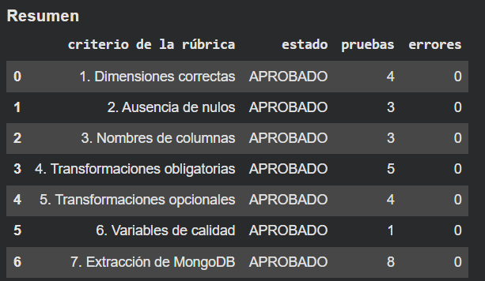

# 6. Validación de salida.csv

[← Volver al índice](../../report.md)

## 6.1 Estrategia

La salida se validó en dos niveles:

1. **Durante la ejecución:** se revisaron las filas leídas y escritas por cada copia y por cada sink en el monitor de ADF ([Tabla 1](02_fuentes_exploracion.md) y [Tabla 3](05_implementacion_adf.md)).
2. **Con el notebook del curso** [`validar_salida_ames.ipynb`](../../notebooks/validar_salida_ames.ipynb):
   - `NAMING_STYLE = "camelCase"`;
   - lee `out/salida.csv` y compara contra las fuentes de `sources/` (CSV, scripts SQL y colecciones JSON);
   - revisa **por fila y por PID**, no solo totales.

## 6.2 Resultado

- **Archivo validado:** `out/salida.csv`, generado por la ejecución del 26/11/2026 (8:21–8:29 p. m.).
- **Resultado:** **28 de 28 pruebas aprobadas, 0 fallidas.** Los siete criterios de la rúbrica quedan en APROBADO (Figura 8).

*Figura 8. Resumen por criterio de `validar_salida_ames.ipynb`, ejecutado en Google Colab sobre `salida.csv` con `NAMING_STYLE = "camelCase"`: 28 pruebas y 0 errores.*

**Tabla 4.** Resultados del notebook de validación.

| # | Criterio | Prueba | Estado | Resultado observado |
|---|---|---|---|---|
| 1 | 1. Dimensiones correctas | Carga de salida.csv | APROBADO | Archivo leído con separador ';': 2930 filas y 81 columnas. |
| 2 | 1. Dimensiones correctas | Dimensiones 2930 × 81 | APROBADO | Esperado: (2930, 81); recibido: (2930, 81). |
| 3 | 1. Dimensiones correctas | PID válido y único | APROBADO | PID inválidos: 0; filas con PID duplicado: 0. |
| 4 | 3. Nombres de columnas | Encabezados exactos en camelCase y orden correcto | APROBADO | Los 81 encabezados coinciden exactamente. |
| 5 | 3. Nombres de columnas | Encabezados sin duplicados | APROBADO | No hay encabezados duplicados. |
| 6 | 3. Nombres de columnas | Encabezados sin espacios | APROBADO | No se encontraron espacios. |
| 7 | 2. Ausencia de nulos | Marcadores de faltantes | APROBADO | Solo se usan NA en cualitativos y valores numéricos —incluido 0— en numéricos. |
| 8 | 2. Ausencia de nulos | Compatibilidad de tipos y marcadores | APROBADO | Los campos cualitativos y numéricos usan representaciones compatibles. |
| 9 | 2. Ausencia de nulos | Espacios alrededor de valores | APROBADO | No se detectaron espacios al inicio o final de valores. |
| 10 | 4. Transformaciones obligatorias | Gr Liv Area por fila | APROBADO | Filas que no cumplen 1st + 2nd + Low Qual = Gr Liv Area: 0. |
| 11 | 4. Transformaciones obligatorias | Year Remod Add sin marcador 0 | APROBADO | Filas donde Year Remod Add continúa vacío, no numérico o en 0: 0. |
| 12 | 1. Dimensiones correctas | Cobertura de PID frente al CSV base | APROBADO | PID faltantes: 0; PID adicionales: 0. |
| 13 | 4. Transformaciones obligatorias | Year Remod Add contra la fuente | APROBADO | PID con valor distinto al original o a Year Built cuando faltaba remodelación: 0. |
| 14 | 4. Transformaciones obligatorias | Agregación de FloorDetail por PID | APROBADO | Diferencias por campo: {'bedroom': 0, 'fullBath': 0, 'halfBath': 0}. |
| 15 | 4. Transformaciones obligatorias | Mes y año derivados de Sale Date | APROBADO | Diferencias por campo: {'moSold': 0, 'yrSold': 0}. |
| 16 | 5. Transformaciones opcionales | Opcional: Neighborhood | APROBADO | La columna conserva de forma consistente los valores originales. |
| 17 | 5. Transformaciones opcionales | Opcional: Condition 1 | APROBADO | La columna conserva de forma consistente los valores originales. |
| 18 | 5. Transformaciones opcionales | Opcional: Condition 2 | APROBADO | La columna conserva de forma consistente los valores originales. |
| 19 | 5. Transformaciones opcionales | Opcional: Lot Shape | APROBADO | La columna conserva de forma consistente los valores originales. |
| 20 | 6. Variables de calidad | Códigos de calidad derivados de TypeQuality | APROBADO | Diferencias por campo: {'exterCond': 0, 'exterQual': 0, 'heatingQC': 0, 'kitchenQual': 0}. |
| 21 | 7. Extracción de MongoDB | Cardinalidad de garage | APROBADO | 2773 documentos; ningún PID duplicado o ausente. |
| 22 | 7. Extracción de MongoDB | Valores de garage por PID | APROBADO | Diferencias por campo: {'garageType': 0, 'garageYrBlt': 0, 'garageFinish': 0, 'garageCars': 0, 'garageArea': 0, 'garageQual': 0, 'garageCond': 0}. |
| 23 | 7. Extracción de MongoDB | Cardinalidad de pool | APROBADO | 13 documentos; ningún PID duplicado o ausente. |
| 24 | 7. Extracción de MongoDB | Valores de pool por PID | APROBADO | Diferencias por campo: {'poolArea': 0, 'poolQC': 0}. |
| 25 | 7. Extracción de MongoDB | Cardinalidad de bsmt | APROBADO | 2851 documentos; ningún PID duplicado o ausente. |
| 26 | 7. Extracción de MongoDB | Valores de bsmt por PID | APROBADO | Diferencias por campo: {'bsmtQual': 0, 'bsmtCond': 0, 'bsmtExposure': 0, 'bsmtFinType1': 0, 'bsmtFinSf1': 0, 'bsmtFinType2': 0, 'bsmtFinSf2': 0, 'bsmtUnfSf': 0, 'totalBsmtSf': 0, 'bsmtFullBath': 0, 'bsmtHalfBath': 0}. |
| 27 | 7. Extracción de MongoDB | Cardinalidad de misc | APROBADO | 106 documentos; ningún PID duplicado o ausente. |
| 28 | 7. Extracción de MongoDB | Valores de misc por PID | APROBADO | Diferencias por campo: {'miscFeature': 0, 'miscVal': 0}. |

## 6.3 Interpretación

- **Dimensiones y PID:** hay 2.930 filas, una por propiedad, sin duplicados y con la misma cobertura que el CSV base. Esto confirma que ninguna unión eliminó ni multiplicó propiedades ([sección 3.4](03_diseno_integracion.md)).
- **Esquema:** los 81 encabezados están en camelCase y en el orden del enunciado, sin espacios, con `PID`, `MS` y `QC` en mayúscula.
- **Faltantes:** no hay celdas vacías. Solo aparecen `NA` en los campos cualitativos y valores numéricos (incluido `0`) en los numéricos. La mayoría de los `NA` corresponde a casas sin documento de piscina o de `misc`, que son casi todas.
- **Transformaciones obligatorias:** las cuatro reglas (Gr Liv Area, FloorDetail, mes y año, Year Remod/Add) tienen **0 diferencias** por fila o por PID contra la fuente.
- **MongoDB:** los valores coinciden campo a campo en las cuatro colecciones. Esto confirma que el `NA` / `0` se aplicó solo donde faltaba el documento o el campo.

## 6.4 Errores detectados durante el desarrollo y cómo se resolvieron

El notebook se usó durante todo el desarrollo, no solo al final. En las primeras ejecuciones detectó:

- encabezados que no coincidían con el contrato de 81 campos (solo 3 de 81);
- la salida partida en varios archivos `part-*.csv`;
- fuentes de Neon y Mongo cruzadas en la unión final;
- `Central Air` convertido dos veces;
- faltantes que no se rellenaban por errores tipográficos en los nombres de las variables: `Central Air` con espacio en la lista de la regla, y el nombre interno `lectrical`, que solo funciona si se usa igual en todo el flujo;
- mes y año calculados sobre una fecha con hora.

Cada hallazgo se resolvió en el pipeline (ver la [sección 5.6](05_implementacion_adf.md)). Después se volvió a ejecutar el pipeline completo y se validó de nuevo, hasta llegar al resultado final: 28/28.
