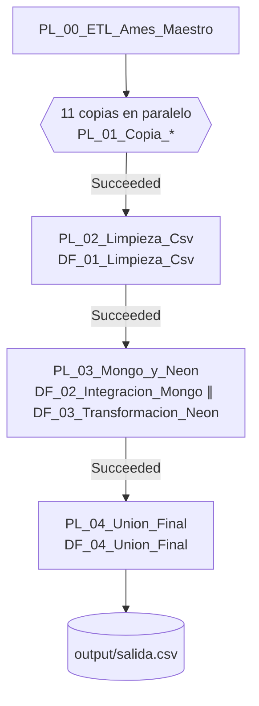

# Pipeline de ADF – Proyecto Ames

Esta carpeta es la **carpeta raíz de la integración Git** de la factoría `adf-ames-etlinmo-corregido`, con la rama de colaboración `main` y la rama de publicación `adf_publish`. ADF genera y actualiza los JSON de las subcarpetas.

| Carpeta | Contenido |
|---|---|
| [`pipeline/`](pipeline/) | 15 pipelines: `PL_00` maestro, 11 `PL_01_Copia_*`, `PL_02`, `PL_03` y `PL_04` |
| [`dataflow/`](dataflow/) | 4 Mapping Data Flows, del `DF_01` al `DF_04` |
| [`dataset/`](dataset/) | 26 datasets: `DS_SRC_` (origen), `DS_STG_` (staging), `DS_INT_` (intermedios) y `DS_OUT_` (salida) |
| [`linkedService/`](linkedService/) | 3 conexiones: `LS_Blob_Ames`, `LS_Neon_AmesDB` y `LS_Mongo_Atlas`. ADF guarda las contraseñas cifradas en Azure |
| [`factory/`](factory/) | Definición de la factoría |
| [`arm/`](arm/) | Plantilla ARM para desplegar la factoría completa |

## Arquitectura

## Pipelines

Los pipelines organizan el trabajo y definen el orden. Los `PL_01` **extraen**: copian cada fuente tal cual a archivos CSV en Blob Storage (staging). Los `PL_02`, `PL_03` y `PL_04` **transforman**: cada uno ejecuta uno o dos data flows. `PL_00` los encadena todos, así que basta con ejecutarlo a él.

| Pipeline | Actividad | Qué hace |
|---|---|---|
| `PL_00_ETL_Ames_Maestro` | 14 × Execute Pipeline | Es el que hay que ejecutar. Corre las 11 copias en paralelo y luego PL_02 → PL_03 → PL_04, cada paso solo si el anterior terminó bien |
| `PL_01_Copia_Csv_AmesProperty` | `CP_Csv_AmesProperty` | `input/AmesProperty.csv` → `AmesPropertyData.csv` |
| `PL_01_Copia_Neon_<tabla>` (6) | `CP_Neon_<tabla>` | Tablas `amesdbtemp`, `floordetail`, `saleproperty`, `typequality`, `mszoning` y `mssubclass` → `Neon/*.csv` |
| `PL_01_Copia_Mongo_<colección>` (4) | `CP_Mongo_<colección>` | Colecciones `garage`, `bsmt`, `pool` y `misc` → `mongo/*.csv`, con mapeo de rutas `$['campo']` |
| `PL_02_Limpieza_Csv` | `EJ_DF_01_Limpieza_Csv` | Ejecuta DF_01, que limpia el CSV de propiedades |
| `PL_03_Mongo_y_Neon` | `EJ_DF_02…`, `EJ_DF_03…` | Ejecuta en paralelo DF_02 (pega los datos de MongoDB) y DF_03 (prepara los datos de Neon) |
| `PL_04_Union_Final` | `EJ_DF_04_Union_Final` | Ejecuta DF_04, que produce `output/salida.csv` |

## Data flows

Los data flows son donde se transforman los datos: limpian, calculan, traducen códigos y unen las fuentes por `PID`. Cada uno deja su resultado en un archivo que usa el siguiente, y el último produce `salida.csv`.

| Data flow | Qué hace | Pasos principales | Salida |
|---|---|---|---|
| `DF_01_Limpieza_Csv` | Limpia el CSV: completa `Lot Frontage` con el promedio del barrio, reemplaza `Year Remod/Add` vacío por `Year Built` y marca faltantes con NA / 0 | `srcCasasCsv` → `aggPromedioLotFrontage` + `joinPromedioBarrio` → `drvLotFrontage` → `selColumnasCsv` → `drvYearRemodAdd` (**REGLA** Year Remod/Add) → `drvFaltantesCsv` → `snkCasasLimpias` | `clean/casas_limpias.csv` |
| `DF_02_Integracion_Mongo` | Pega a cada casa sus datos de garaje, sótano, piscina y otros (MongoDB), sin perder las casas que no tienen documento | `srcCasasLimpias`, `srcGarage`, `srcSotano`, `srcPiscina` y `srcMisc` → `drvPid*` (PID a texto) → `joinGarage` → `joinSotano` → `joinPiscina` → `joinMisc` (LEFT) → `snkCasasMongo` | `clean/MONGO1.csv` |
| `DF_03_Transformacion_Neon` | Prepara la construcción (Neon): calcula `Gr Liv Area`, pasa `Central Air` a Y/N y traduce los códigos de calidad y de zona con los catálogos | `srcConstruccion` → `drvGrLivAreaAire` (**REGLA** Gr Liv Area; Central Air Y/N) → `lkpExterQual`, `lkpExterCond`, `lkpHeatingQC`, `lkpKitchenQual` (`srcCalidades`) y `lkpMSZoning` (`srcZonas`) → `selConstruccionFinal` → `snkNeon` | `clean/neon1.csv` |
| `DF_04_Union_Final` | Une todo por `PID`: suma habitaciones y baños por casa, saca mes y año de venta, aplica NA / 0 y ordena las 81 columnas en camelCase | `srcPisos` → `aggPisosPorCasa` (**REGLA** suma por PID); `srcVentas` → `drvMesAnioVenta` (**REGLA** mes y año); `srcCasasMongo` [LEFT JOIN] `srcNeon` [LEFT JOIN] pisos [LEFT JOIN] ventas → `selSinDuplicados` → `drvFaltantesNAyCero` (**REGLA** NA / 0) → `selEsquemaSalida` (81 columnas en camelCase) → `snkSalida` | `output/salida.csv` |

Cada pipeline, actividad, dataset, data flow y paso interno tiene una descripción en ADF. Los pasos que implementan una regla del enunciado empiezan su descripción con «REGLA:».

## Cómo desplegar y ejecutar

1. **Opción A, desde Git:** en ADF Studio, ir a **Administrar → Configuración de Git** y seleccionar GitHub, el repositorio `Proyecto-Ames`, la rama `main` y la carpeta raíz `/pipelines/`. Luego **Publicar**.
2. **Opción B, con la plantilla ARM:** en el portal de Azure, usar **Implementación personalizada → Cree su propia plantilla** y pegar `arm/ARMTemplate_ETL_Ames.json`. Ingresar la región y las tres cadenas de conexión, que son parámetros seguros. La plantilla trae `northcentralus` porque es la región donde se desplegó este proyecto; use esta o la región permitida para su propia cuenta de Azure.
3. Subir `AmesProperty.csv` a `sources/input/` y probar las conexiones en **Servicios vinculados**.
4. Ejecutar `PL_00_ETL_Ames_Maestro` con **Agregar desencadenador → Desencadenar ahora** y seguirlo en **Supervisar**.
